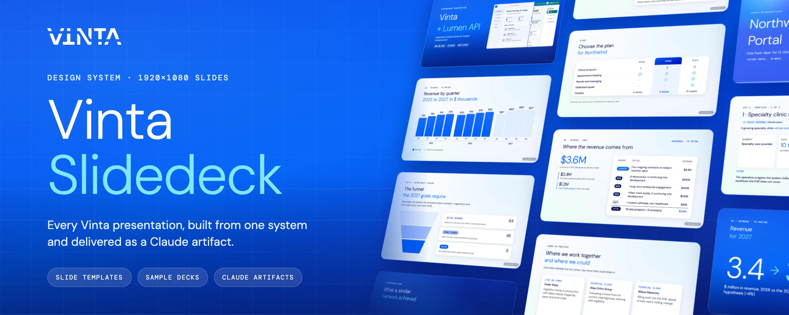

# Vinta Slidedeck

Vinta's presentation design system (the vintasoftware.com site look) as a **React slide deck**: ~70 ready slide patterns, slides written as `.tsx` or plain **markdown**, a
**presenter window** with speaker notes, **PDF/PPTX export**, and one-command **Claude artifacts** to share a
deck as a link. Building a deck is picking patterns and passing your content — easy to do with an AI agent.

```bash
npm install
npm run dev      # http://localhost:5173  → your deck
```

## Start a new deck

**One repository per deck.** On GitHub, use **"Use this template"** on `vintasoftware/vinta-slidedeck` to
create the deck's repository (a workflow renames the copy on its first push), clone it, `npm install`, then open
Claude Code in it and ask for the deck (`/create-deck`): it asks what's missing, proposes an outline, builds the
slides, checks them and publishes the deck as a private link when you approve. Ready-made prompts and rules:
**[docs/team-guide.md](docs/team-guide.md)**.

The slides are files in `src/slides/` (`.tsx` or `.md`). Storybook, the template gallery, `/patterns` and
`/samples` are the reference to pick templates from — your slides never become stories. To see every template:
`npm run gallery` (opens http://localhost:6007: templates grouped by what they're for, with a screenshot of each
variant, when to use it and its limits).

## Decks (by URL)

| URL | Deck | Folder |
|---|---|---|
| `/` | **Your slides** — build your presentation here | `src/slides/` |
| `/patterns` | Every pattern, with examples — pick from here | `src/components/patterns/` |
| `/samples` | Sample presentations built from the patterns (fictional data) | `src/samples/` |

**Controls:** `←/→`/`Space` or a click navigate (left third of the window goes back) · `o` overview · `f` fullscreen · `p` presenter window (clock,
timer, speaker notes, previous/next slides — synced with the deck window) · number + `Enter` to jump ·
`#/N` deep-links a slide within the current deck.

## Commands

| Command | What it does |
|---|---|
| `npm run dev` | The decks at http://localhost:5173 |
| `npm run gallery` | Builds the template gallery (`gallery/`) and serves it on port 6007; `gallery:build` only builds (`--skip-existing` reshoots only new stories). Categories and labels live in `scripts/gallery-catalog.mjs` |
| `npm run storybook` | Storybook on port 6006: every pattern and element with its props, plus the foundations pages (for whoever edits the design system); `build-storybook` builds it statically |
| `npm run build` | Typecheck + production build |
| `npm run build-deck [-- samples] [--shots] [--name "Title"]` | Your deck as one self-contained HTML in `output/exports/<name>/`, ready to publish as a Claude artifact (with `text.txt` to scan and `artifact.json`). PNGs over 100 KB go in as WebP (needs `cwebp`: `brew install webp`; without it they go in uncompressed) and the build fails over the artifact's 16 MB limit. See the publish-deck skill |
| `npm run export` | PDF + editable PPTX of your deck in `export/` (`--format pdf\|pptx`, `--deck patterns\|samples`) |
| `npm run render-clip -- <story-id> --out <name>` | Records an animated story as a looping MP4 + cover PNG in `output/exports/clips/`, for use outside the deck (email, Google Slides). Storybook must be running; needs `ffmpeg`. `--transparent` (WebM with alpha), `--selector`, `--seconds`, `--skip`… (header of `scripts/render-clip.mjs`) |
| `npm run test-storybook` | Renders every Storybook story in headless Chromium (Vitest); a11y issues are reported |
| `npm run sync-harness` | Regenerates the token reference in `docs/foundations.md` from `src/components/tokens.css` |
| `npm run team-photos -- crops` | Re-cuts the team photos in `public/assets/team/` from `assets/team-photos/` per `crops.json` (`library <dir>` adds originals; needs `cwebp`) |
| `npm run init -- <name>` | Rename a copy of this template (package, page title, this heading) |

## Where things are

- **[src/components/CATALOG.md](src/components/CATALOG.md)** — every pattern: when to use it, its props, item
  and character limits, plus the design rules and how to add a pattern. Patterns and their elements import from
  `@/components`; each has a Storybook story next to it.
- **[AUTHORING.md](AUTHORING.md)** — writing slides in `.tsx`: the workflow, bespoke slides, code slides.
- **[MARKDOWN.md](MARKDOWN.md)** — writing slides as `.md` files that fill a pattern.
- **`src/lib/`** — the deck runtime (`@/lib`): navigation, overview, presenter window, capture modes, markdown parser.
- **[docs/](docs/)** — `team-guide.md` (no-code guide), `foundations.md` (tokens, palette), `layout.md` (slide
  anatomy), `known-issues.md`.
- **Agent skills** — `create-deck` (build a deck) and `publish-deck` (share it as an artifact).

### AI agent instructions (single source, many tools)

The skills are [Agent Skills](https://agentsmd.net/) authored **once** at the vendor-neutral
`.agents/skills/<name>/SKILL.md`, and each tool reads them from its expected path:

| Tool | Path it reads | Kind |
|---|---|---|
| **Cursor**, **GitHub Copilot** | `.agents/skills/<name>/SKILL.md` | canonical file (read natively) |
| **Claude Code** | `.claude/skills/<name>/SKILL.md` | → symlink to canonical |
| **OpenAI Codex** | `.codex/skills/<name>/SKILL.md` | → symlink to canonical |

Edit only the files under `.agents/skills/`; the others are symlinks, so there's nothing to keep in sync.
(Symlinks need `git config core.symlinks true` on Windows checkouts.)

## Self-contained

Fonts (DM Sans, DM Mono), icons and every image the patterns use are bundled (`public/assets/<pattern>/`), so the
app, its exports and its artifacts run with no external requests.
